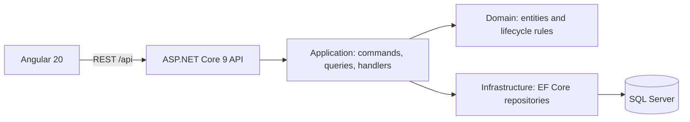

# EIH (Enterprise Integration Hub)

> A full-stack workspace for cataloging enterprise systems, configuring API connectors, and governing event-routing workflows.

Enterprise Integration Hub (EIH) is an MVP for the **configuration and governance layer** of an integration platform. It gives an operations team one place to register systems, describe connection contracts, and activate workflows only when their dependencies are ready.

This is not yet a production-ready message-processing platform. Authenticated event ingestion and Kafka outbox publication are implemented; destination execution is under review, while transformations, operator authentication, monitoring, and audit history remain incomplete.

## The problem

Point-to-point enterprise integrations duplicate logic and make ownership difficult as systems multiply. EIH makes the prerequisites for a reliable integration explicit:

1. Register an external system such as a CRM, ERP, or payroll platform.
2. Configure its connector: endpoint, protocol, authentication type, and timeout.
3. Define an ordered workflow from a source connector to one or more destinations.
4. Activate the workflow only after each referenced connector is active.

## Implemented capabilities

- Create, browse, view, update, activate, and deactivate external systems.
- Configure and manage HTTP/HTTPS connector contracts.
- Create, browse, update, view, and activate ordered event-routing workflows.
- Enforce lifecycle rules: source/destination separation, positive unique step order, draft-only workflow edits, and active dependencies before workflow activation.
- Return an active connector to Draft when its communication settings change, requiring review before reactivation.
- Provide an Angular operator UI with dashboard, forms, search, empty/error states, and API health feedback.
- Provide REST APIs, Development Swagger/OpenAPI, EF Core migrations, test projects, and GitHub Actions backend CI.
- Accept authenticated events with duplicate protection and a transactional execution outbox.

## Architecture



The backend is a modular monolith with clear responsibilities:

| Layer | Responsibility |
| --- | --- |
| API | HTTP, request/response contracts, composition |
| Application | Use cases, handlers, repository abstractions |
| Domain | Business entities and rules, independent of ASP.NET Core and EF Core |
| Infrastructure | EF Core mappings, SQL Server persistence, repositories |

## Stack

| Area | Technology |
| --- | --- |
| Frontend | Angular 20, TypeScript, RxJS |
| Backend | ASP.NET Core 9, C# |
| Data | SQL Server, Entity Framework Core 9, migrations |
| Local development | Docker Compose |
| API discovery | Swagger / OpenAPI in Development |
| Quality | xUnit, GitHub Actions, Coverlet coverage artifacts |

Compose includes Kafka-compatible Redpanda for the optional outbox publisher. Redis and Azurite are local scaffolding and are not currently wired into application behavior.

## Run locally

Prerequisites: .NET 9 SDK, Node.js compatible with Angular 20, and Docker Desktop.

```bash
# Start SQL Server
docker compose -f infrastructure/docker-compose.yml up -d eih-sqlserver

# Apply migrations using the configured development connection
dotnet ef database update --project backend/src/EnterpriseIntegrationHub.Infrastructure --startup-project backend/src/EnterpriseIntegrationHub.Api

# Start the API
dotnet run --project backend/src/EnterpriseIntegrationHub.Api --launch-profile http

# Install dependencies once, then run the frontend
npm install
npm run start
```

Open `http://localhost:4200`. The frontend proxies `/api` to `http://localhost:5194`; Swagger is at `http://localhost:5194/swagger`.

> The Compose password is for local development only. Use secure environment-based configuration before shared or production deployment.

## Validate

```bash
dotnet test backend/EnterpriseIntegrationHub.sln
npm run build
```

## Core rules

| Area | Rule |
| --- | --- |
| Connector | Changing endpoint, protocol, authentication type, or timeout on an active connector returns it to Draft. |
| Workflow | Requires at least one destination step; steps must have positive, unique orders; source cannot be a destination. |
| Activation | A workflow activates only when its source and all destination connectors are active. |
| Editing | Workflows can be updated only while Draft. |

## API surface

| Resource | Operations |
| --- | --- |
| `/api/external-systems` | Create, list, get, update, activate, deactivate |
| `/api/connectors` | Create, list, get, update, activate, deactivate |
| `/api/workflows` | Create, list, get, update, activate |

Run locally and use Swagger for request/response models.

## Repository layout

```text
backend/          API, application, domain, infrastructure, and tests
frontend/         Angular workspace and web client
infrastructure/   Docker Compose services for local development
```

## Roadmap

Next slices include delivery, transformations, monitoring, authentication/authorization, audit history, and production secret management.

## License

[MIT](LICENSE)
