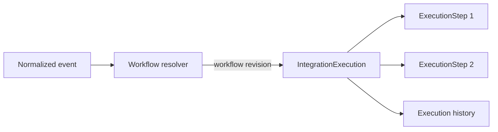

# Runtime Execution Domain Decisions

**Status:** Accepted design baseline for completed issue [#49](https://github.com/prajwalkuchewar/enterprise-integration-hub/issues/49), merged in PR #65. Execution persistence is being delivered in the dependent #50 branch; workers remain future work.

## Purpose and boundary

An integration execution is one durable record of an accepted source event being processed against one immutable workflow revision. It answers what event was accepted, which workflow revision was selected, which destination steps were planned, and how each step ended.

The execution domain owns lifecycle state and history. It does not own source business data, transport adapters, connector HTTP behavior, credentials, or workflow resolution. Ingestion normalizes an event; workflow resolution selects an active workflow revision; execution creation snapshots the resolved plan; a worker performs side effects.

## Business decisions

### IntegrationExecution

- The application execution service creates it only after an event is accepted and a resolver supplies an active workflow revision. Resolution is a separate capability tracked by issue #51; this issue does not implement resolution.
- It is the aggregate root and owns one event occurrence, its chosen workflow revision, correlation and idempotency identity, lifecycle timestamps, outcome, and its ordered execution steps.
- The inbound event identity is the source system plus the source event ID. A unique event-receipt record prevents duplicate delivery from starting the event twice. The normalized event fingerprint is also stored: a duplicate identity with the same fingerprint returns the existing execution; the same identity with different content is rejected and recorded as an ingestion conflict. Operator replays are explicit new executions linked to the original receipt and do not create another inbound receipt.
- It refers to an immutable `WorkflowRevision`; it never points at a mutable Draft workflow as its execution plan. The current integer revision counter is not itself a persisted revision snapshot. Persisting that snapshot is required before execution creation ships.
- The execution stores only the normalized envelope and safe diagnostic metadata needed for traceability. It does not store credentials or unredacted connector responses. Raw payload storage and retention require a separate encrypted payload-storage decision.

### ExecutionStep

- A step is one planned destination action within one execution. It is a child owned by that execution, ordered by the immutable workflow revision, and is not reusable workflow configuration.
- At creation it snapshots the destination connector ID and the non-secret connector settings needed to make the run reproducible. Credentials are represented by secret references and resolved by the worker at attempt time; secret values are never copied into execution history.
- It owns its state, timestamps, attempt history, and sanitized last error. An append-only `ExecutionStepAttempt` record captures each physical attempt, including start/end, outcome, retry classification, and redacted diagnostic data.

### Execution lifecycle and failure behavior

Execution states are `Queued`, `Running`, `RetryScheduled`, `Succeeded`, `Failed`, and `Cancelled`.

| Current state | Event | Next state |
| --- | --- | --- |
| Queued | Worker claims execution | Running |
| Running | All steps succeeded | Succeeded |
| Running | Transient step failure with retry budget remaining | RetryScheduled |
| RetryScheduled | Retry becomes due and worker claims it | Running |
| Running | Permanent failure or retry budget exhausted | Failed |
| Queued / RetryScheduled | Authorized cancellation before work starts | Cancelled |
| Running | Cooperative cancellation between attempts/steps | Cancelled |

Execution is sequential in the first runtime slice. If step 2 fails, the failure is recorded on step 2 and subsequent steps become `Skipped`; completed steps remain completed. The workflow does not roll back external side effects. The execution remains retryable only while its bounded automatic retry policy allows it.

Step states are `Pending`, `Running`, `RetryScheduled`, `Succeeded`, `Failed`, and `Skipped`. Only the failed step is retried automatically. Each retry is a new attempt under the same step and execution, using the same persisted logical-step idempotency key. Operator replay carries that key forward for the resumed step. A timeout or connection loss can have an unknown remote outcome, so destination calls must support idempotency or be reported as at-least-once with possible duplicate effects.

For the initial HTTP adapter, network failures, timeouts, HTTP 408, HTTP 429, and HTTP 5xx are transient. Other 4xx responses are terminal until configuration or input changes. Retries are bounded exponential backoff with jitter; the exact maximum and timing are deployment policy, not workflow configuration.

Automatic retry and operator replay are different operations. An operator replay creates a new execution linked to the failed execution, pins the same workflow revision, and resumes at the failed step by default. It receives a new execution ID while preserving the source-event identity, event-receipt link, and logical-step idempotency key; it records the operator and reason. Replaying the entire workflow, compensation, and editing/replacing event data are out of scope for the first runtime slice.

Cancellation is cooperative. It prevents new work and cancels an in-flight request when possible; it cannot undo an external side effect already accepted by a destination. Cancellation and every terminal transition are recorded in history.

### Delivery, transaction, and history ownership

- Delivery is at least once. The system must not claim exactly once across the database and an external destination.
- Execution creation writes the execution, its ordered step snapshots, and a dispatch/outbox record in one database transaction. No database transaction is held open while a destination request runs.
- The worker claims work with a lease or equivalent concurrency guard. State transitions use optimistic concurrency so two workers cannot both own the same attempt.
- EIH owns durable execution and attempt history. Source systems remain authoritative for the source event. History records sanitized outcomes and correlation data; raw payload retention, data erasure, and retention periods must be set by the operations/security design before production use.
- A failed execution is terminal after automatic retries. Dead-letter storage, dashboards, and operator replay authorization are later resilience/operations work; the domain must retain enough information to support them without mutating the failed record.

## Domain responsibilities

| Concept | Owns | Does not own |
| --- | --- | --- |
| `IntegrationExecution` | Event identity, selected workflow revision, overall status, ordered steps, lifecycle timestamps, cancellation, final outcome | Event transport, workflow lookup, HTTP calls, credentials |
| `ExecutionStep` | One destination action snapshot, order, step status, attempt collection | Reusable workflow definition, parallel scheduling, connector configuration editing |
| `ExecutionStepAttempt` | One physical invocation outcome, timing, retry classification, redacted diagnostics | Business event identity or workflow selection |
| `WorkflowRevision` | Immutable workflow definition and ordered configured destinations | Runtime progress or attempt history |

## Implementation sequence and acceptance boundary

1. [x] Agree on this contract in issue #49 before domain code is added.
2. Implement #51 before #50: resolve only active workflows by source connector and case-insensitive trigger event; require active source and destination connectors; return no-match and ambiguity as explicit outcomes.
3. Implement workflow revision persistence and execution/step/attempt models, then create execution and dispatch atomically in issue #50.
4. Keep transport ingestion, destination invocation, durable retry scheduling, operator replay, and monitoring in their later vertical slices.

**Exit for #49:** these decisions are recorded in the issue and repository; no domain-model implementation is included in this issue.
